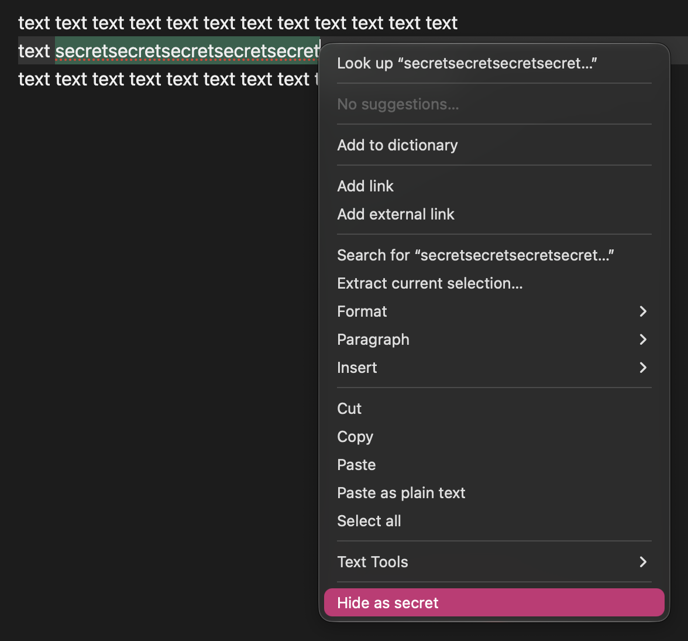
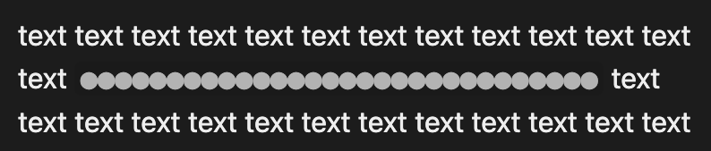
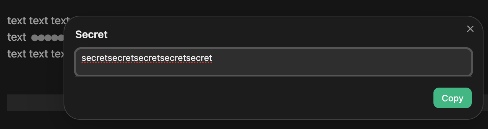
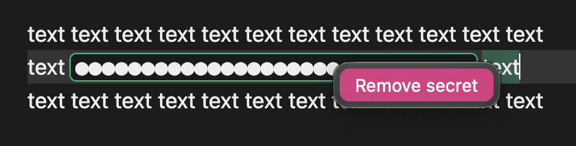

# Veilbit

Veilbit masks secret values in your Obsidian notes and lets you reveal or copy them when needed. In Live Preview and Reading view, secrets are replaced with a configurable mask.

## Installation

Install Veilbit from **Settings → Community plugins → Browse**.

## Important: secret storage

Veilbit does not keep a separate password store and does not send secrets to any external service. Secret values are included in the Markdown note as reversible base64url-encoded text; this is encoding, not encryption. Anyone who can access the note can decode or reveal its secrets. **Sharing, syncing, or transferring a note may expose its secrets to other people. Do not use Veilbit as secure password storage.**

## Usage

1. Select text in the editor and open the context menu, then choose **Hide as secret**.

   

2. The selected text is replaced with a mask in Live Preview.

   

3. Click the masked value in Live Preview to open the secret. Edit the value if needed; changes are saved to the note when you close the dialog. Select **Copy** to copy the current value to your clipboard.

   

4. To restore the original text, right-click the masked secret and choose **Remove secret**.

   

You can also run **Hide selected text as secret** from the Command Palette.

## Settings

- **Mask symbol** — the character used to display a masked secret. Defaults to `●`.
- **Mask length** — set to `0` to show one mask character per character in the secret, or enter a positive number for a fixed mask length.
